# Crew


**Give your AI helpers work. See it get done.**

**Live:** https://crew.paytrackify.com · [Deployment guide](docs/deploy.md)

Crew is a small, calm control panel for running a company with AI helpers. Tell it what
business you run, and it sets up a team, their first tasks, and the context they need. Give
them work; nothing ships until you say it's good.

This is the rebuilt core of the Paperclip idea, with five deliberate changes:

1. **You must sign in.** Every screen and every API call is behind a session. Sign-in is
   passwordless — an 8-digit code by email, validated by PayTrackify.
2. **One job per screen.** No dashboards of dashboards. The home screen answers one question:
   *what needs me right now?*
3. **Plain words.** "Helpers", "tasks", "your OK". No agents, adapters, heartbeats, or runs.
4. **A company, not a chat.** Onboarding asks what you run, builds a preset team of 3 helpers
   with starter tasks, and keeps every company separate. You can run as many as you like.
5. **Marketing that ships.** 53 marketing playbooks attach to any helper, and a teardown tool
   reads a competitor's site and writes the report a founder can copy.

| | |
|---|---|
| Backend | Go 1.24, stdlib HTTP, SQLite (WAL) |
| Companies | Unlimited per person, each with its own helpers, tasks and activity |
| Presets | 66 business types across 11 categories, each with a 3-person team and 3 tasks |
| Skills | 53 marketing skills (MIT) from Corey Haines' marketingskills, attached per helper |
| Ads Studio | Platform-native Meta, TikTok and YouTube concepts, scripts, hooks, test plans and compliance checks |
| Advise Me | Country-aware company study, checklist, next actions, helper creation and a floating advisor |
| Products | Every company can run multiple product workspaces, each with the full feature set |
| Files & financials | Upload evidence; model margin, runway and break-even; audited vs management accounts |
| Integrations | Email, WhatsApp templates, Meta/TikTok/Google Ads controls, SearXNG and Brave Search |
| Portfolio | Consolidated revenue, net, cash and health across every product |
| Search | Self-hosted SearXNG for arbitrary web results; Brave optional |
| Routines | Daily, weekday, weekly or monthly recurring tasks |
| Goals | Numeric goals with progress, due dates and completion |
| Included model | DeepSeek by default, proxied server-side so helpers never see the key |
| Budgets | Monthly AI spend caps per helper and per company, with estimates |
| Team | Invite editors and viewers by email; owner keeps control |
| Notifications | In-app bell for reviews and marketing teardowns |
| Delegation | Helpers can hand work to another helper with a tool call |
| Teardowns | Reverse Engineer Marketing harness (MIT) with 10 channel playbooks |
| Frontend | React 19 + TypeScript + Vite (no UI framework) |
| Sign-in | Passwordless email OTP via PayTrackify (`htdocs/email-finance`) |
| Deploy | One static binary with the UI embedded |

---

## Screens

| Sign in | Home |
|---|---|
| 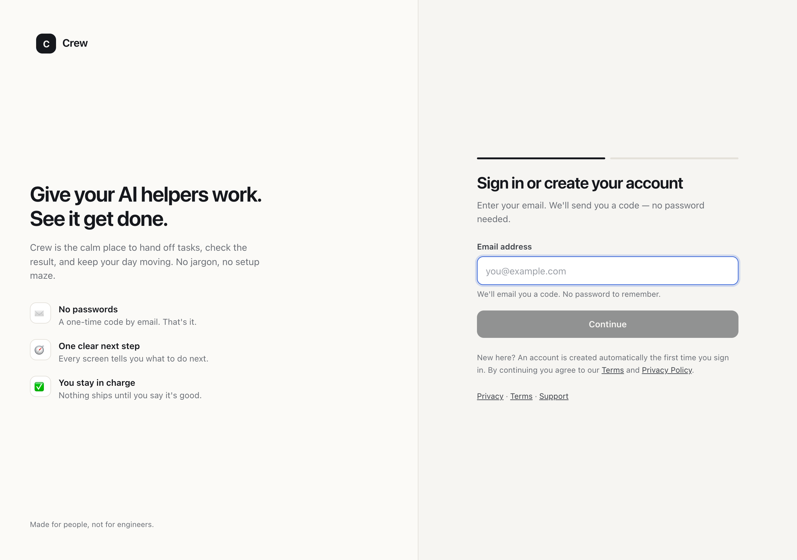 | 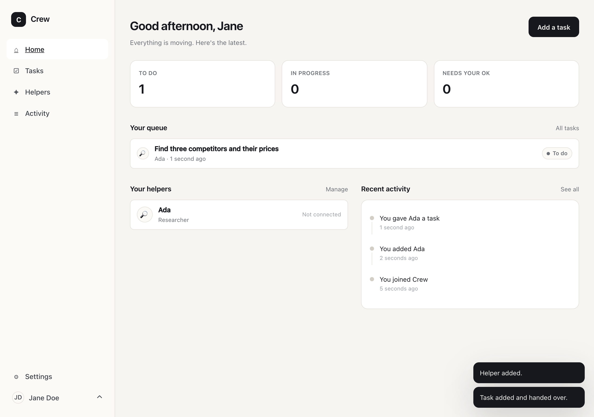 |

| Advise Me | Products |
| 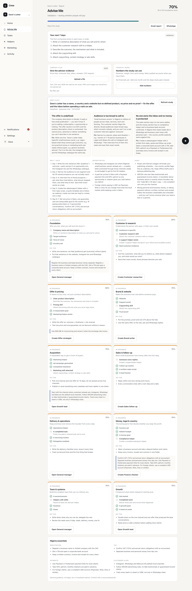 | 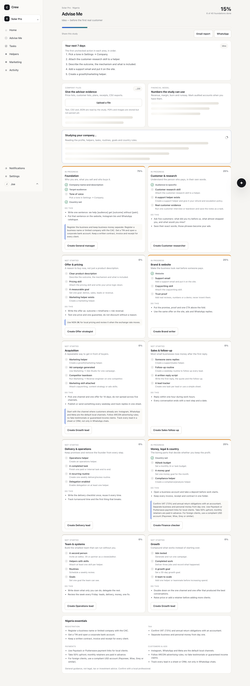 |
| Portfolio | Financial audit |
| 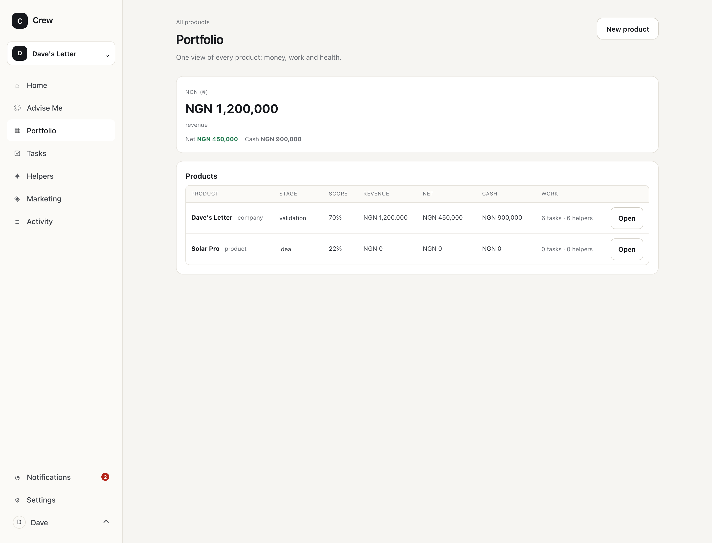 | 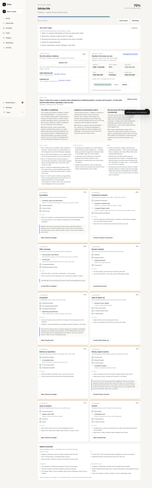 |
| Integrations | Financial model |
| 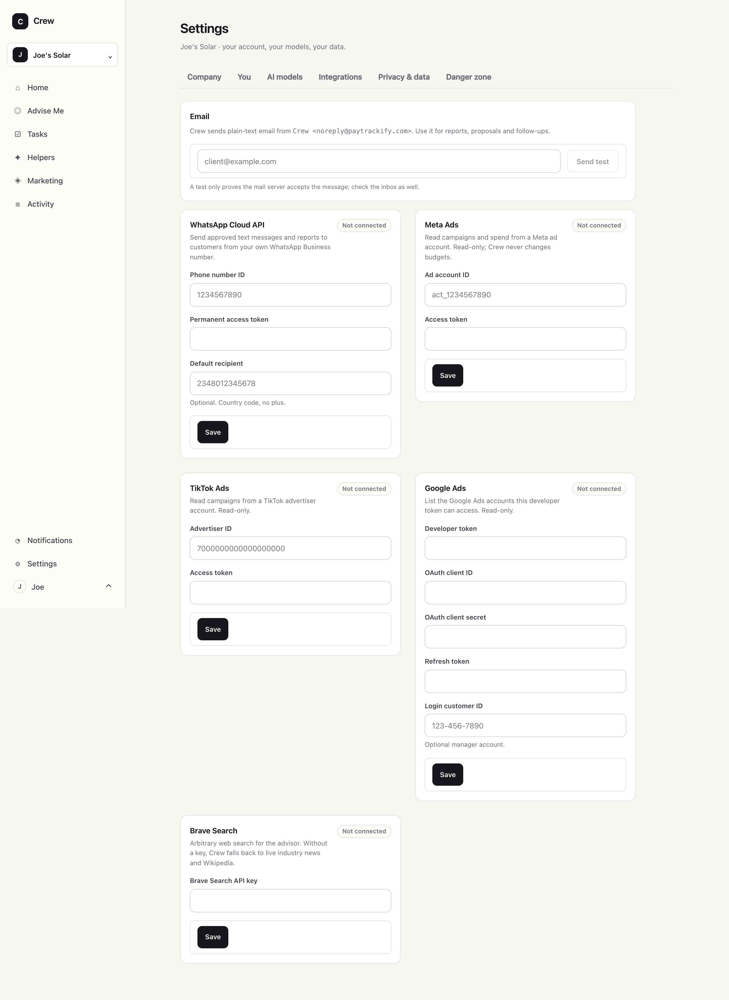 | 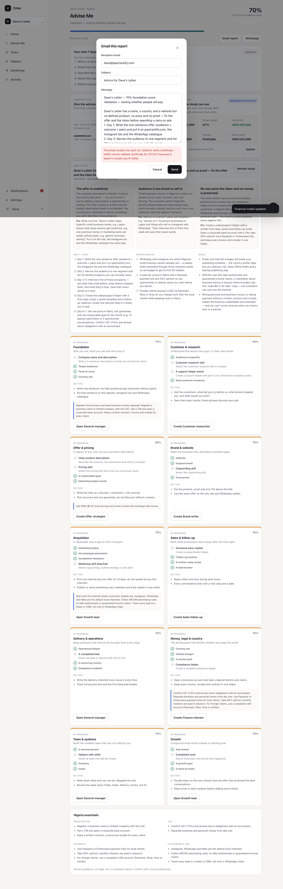 |
| 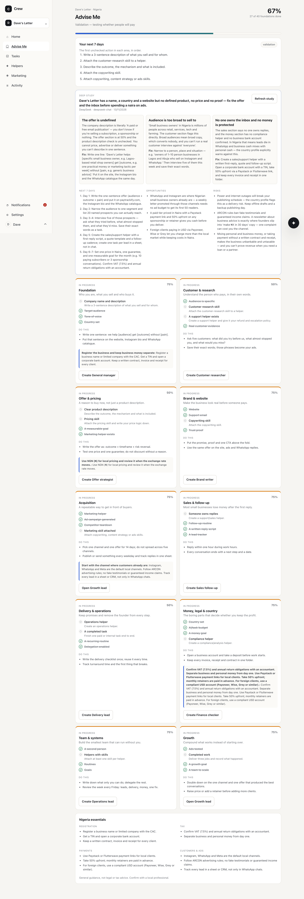 |  |
|  | 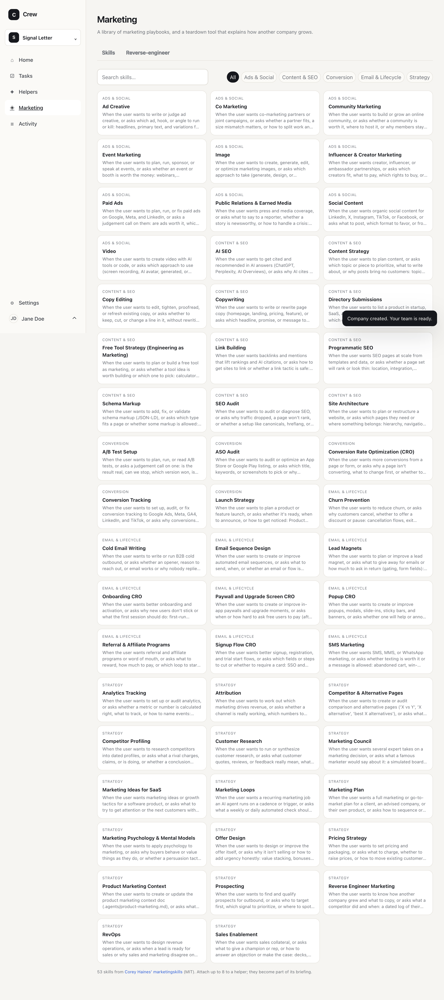 |
|---|---|
|  | 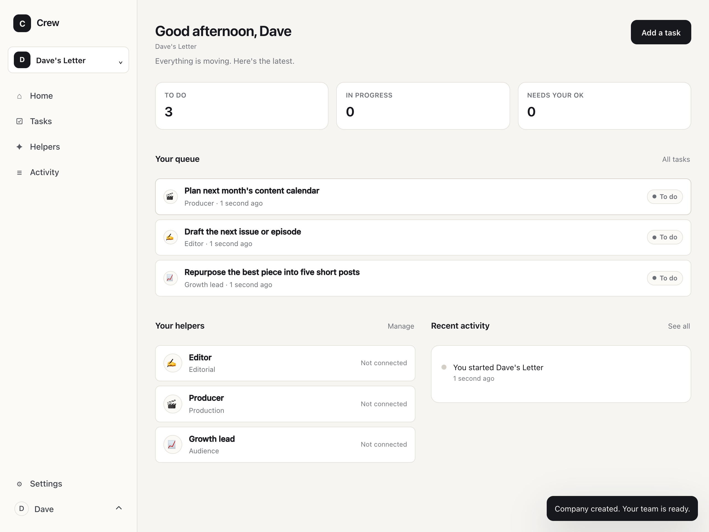 |

| Task | Mobile |
|---|---|
| 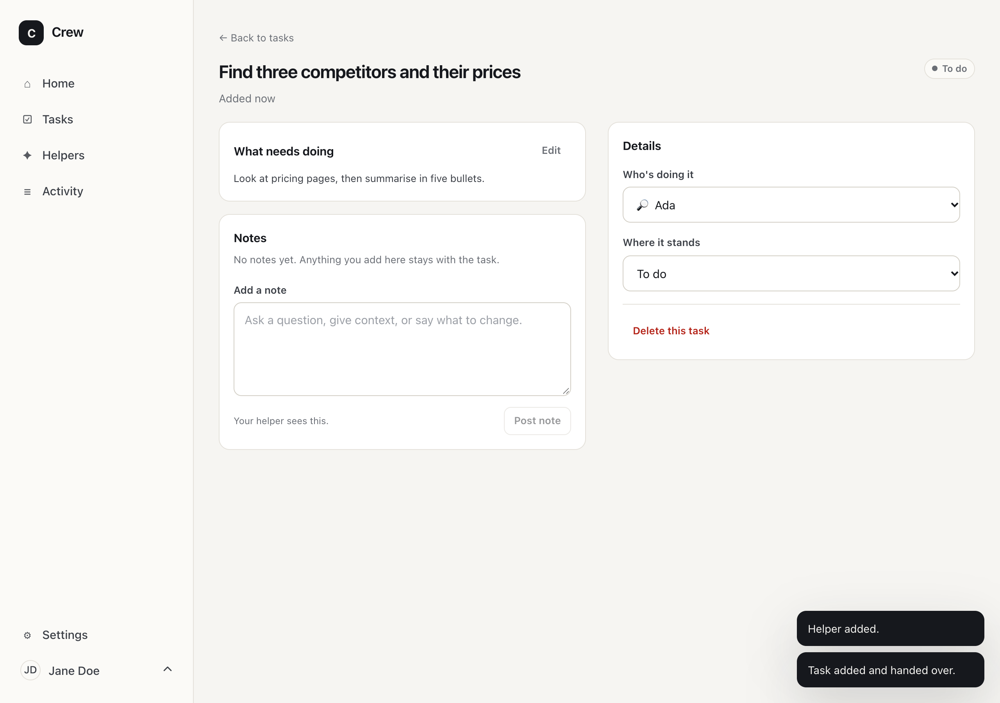 | 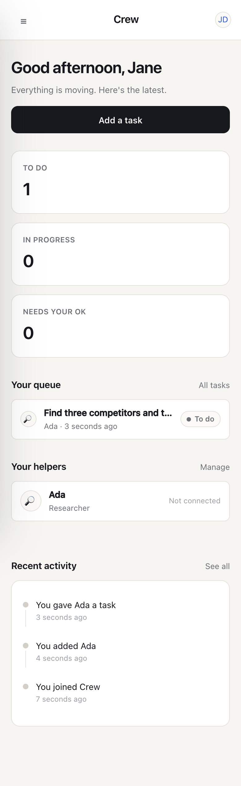 |

The UI audit (all 20 laws, account surfaces, and known deviations) lives in
[`docs/ui-review.md`](docs/ui-review.md).

---

## Quick start (local)

You need Go 1.24+, Node 20+, and the PayTrackify Laravel app running.

### 1. Start PayTrackify (the sign-in authority)

```bash
cd ~/htdocs/email-finance

# Local demo database + codes written to the log instead of email
touch /tmp/paytrackify_dev.sqlite
DB_CONNECTION=sqlite DB_DATABASE=/tmp/paytrackify_dev.sqlite \
CACHE_STORE=file SESSION_DRIVER=file QUEUE_CONNECTION=sync MAIL_MAILER=log \
php artisan migrate --force

cd public
DB_CONNECTION=sqlite DB_DATABASE=/tmp/paytrackify_dev.sqlite \
CACHE_STORE=file SESSION_DRIVER=file QUEUE_CONNECTION=sync MAIL_MAILER=log \
AUTH_SERVICE_KEY=dev-service-key \
php -d display_errors=0 -S 127.0.0.1:8012 \
  ../vendor/laravel/framework/src/Illuminate/Foundation/resources/server.php
```

Codes appear in `storage/logs/laravel.log` (search for `sign-in code is`).

> PHP 8.5 prints a deprecation notice from Laravel's database config on this machine. The
> `-d display_errors=0` flag keeps it out of JSON responses. Production should have
> `display_errors=Off` anyway.

### 2. Build and start Crew

```bash
cd crew
make build          # builds the UI, embeds it, compiles ./bin/crew
PAYTRACKIFY_URL=http://127.0.0.1:8012 ./bin/crew
```

Open **http://127.0.0.1:8787**.

For UI work with hot reload:

```bash
# terminal 1
go run ./cmd/crew

# terminal 2
cd web && npm run dev     # http://127.0.0.1:5173, proxies /api to :8787
```

### 3. Onboard a company

After signing in you will be asked what business you run. Pick from the list (or choose
"Something else"), fill in the name, website, support email and audience, then review the team
Crew will create. The last step connects an AI model — free options are listed first.

You can add another company at any time from the company switcher in the sidebar.

### 4. Give a helper something to do

1. Open **Helpers → Add a helper**. Copy the key and command from the last step.
2. On the machine that should do the work:

   ```bash
   go run ./cmd/crew-worker --server http://127.0.0.1:8787 --key crew_...
   ```

3. Add a task, assign it to that helper, and watch it move to **Needs your OK**.

The worker asks Crew for the helper's model. If a model key is configured, it calls that
provider directly:

```bash
go run ./cmd/crew-worker --key crew_... --mode model
```

It supports OpenAI-compatible providers (OpenAI, OpenRouter, Groq, Mistral, DeepSeek, xAI,
Together, Cerebras, local Ollama), Anthropic, and Google Gemini. With `--mode auto` (the
default) it uses the model when one is configured and otherwise runs the command.

To use your own CLI instead:

```bash
go run ./cmd/crew-worker --key crew_... --mode command \
  --command 'claude -p "Task: $CREW_TASK_TITLE. Details: $CREW_TASK_DETAILS"'
```

### 5. Give a helper a marketing brain

Open **Marketing**. The **Skills** tab lists 53 playbooks — copywriting, pricing, SEO, paid ads,
email, launches, and more. Open one to read it, then attach it to a helper. Attached skills are
appended to that helper's briefing (bounded to 24k characters) every time it claims a task.

The **Reverse-engineer** tab asks for a public company URL, an optional question, and a channel
playbook. Crew fetches the page, applies the analyst harness, calls your model, and saves the
report as a task in **Needs your OK**. It only sees the page you give it; anything else is listed
as unknown.

### 6. Connect an AI model

Open **Settings → AI models** (or the last onboarding step). Each provider card links to its
key page and shows which ones are free:

| Free to start | Paid |
|---|---|
| OpenRouter (`:free` models), Groq, Google Gemini, Mistral, Cerebras, Ollama (local) | OpenAI, Anthropic, DeepSeek, xAI, Together |

Keys are encrypted with AES-256-GCM using `CREW_SECRET_KEY` (or a `0600` key file beside the
database) and are never returned to the browser. A helper reads its key over its own bearer
credential.

---

## Environment

| Variable | Default | What it does |
|---|---|---|
| `CREW_ADDR` | `127.0.0.1:8787` | Listen address. Use `0.0.0.0:8787` behind a proxy. |
| `CREW_DB` | `data/crew.db` | SQLite file. WAL mode, one writer. |
| `PAYTRACKIFY_URL` | `http://127.0.0.1:8012` | Where sign-in is validated. |
| `PAYTRACKIFY_TIMEOUT` | `8s` | Provider call deadline. |
| `CREW_SESSION_CACHE_TTL` | `60s` | How long a validated session is cached. |
| `CREW_SECURE_COOKIES` | `false` | Set `true` (or `CREW_ENV=production`) behind HTTPS. |
| `CREW_ENV` | `development` | `production` forces secure cookies. |
| `CREW_SECRET_KEY` | generated file | 32-byte hex/base64 key for provider-key encryption. Set this in production. |
| `CREW_PLATFORM_PROVIDER` | `deepseek` | Provider used when a helper has no personal model. |
| `CREW_PLATFORM_MODEL` | `deepseek-chat` | Model used for the included provider. |
| `CREW_PLATFORM_API_KEY` | empty | Server-side key for the included model. Never sent to helpers. |
| `CREW_PLATFORM_BASE_URL` | provider URL | Override for a self-hosted OpenAI-compatible endpoint. |
| `CREW_DEFAULT_AI_BUDGET_USD` | `2` | Monthly AI budget for a new company; protects a shared key. |
| `CREW_ADMIN_TOKEN` | empty | Shared token for `GET /internal/stats` and `/internal/user`, used by the PayTrackify monitor. |
| `CREW_WEB_DIR` | embedded | Serve a different UI folder (useful for previews). |

PayTrackify side (`email-finance/.env`):

```dotenv
AUTH_SERVICE_KEY=            # optional; only for /api/auth/introspect
AUTH_OTP_TTL_MINUTES=10
AUTH_OTP_MAX_ATTEMPTS=5
AUTH_OTP_RESEND_COOLDOWN_SECONDS=30
AUTH_OTP_SEND_PER_EMAIL_PER_HOUR=5
AUTH_OTP_SEND_PER_IP_PER_HOUR=20
AUTH_OTP_VERIFY_FAILURES_PER_15_MIN=10
```

---

## How sign-in works

```
Browser ──POST /api/auth/request──▶ Crew ──POST /api/auth/otp/request──▶ PayTrackify
                                    │                                      │
                                    │                              8-digit code by email
Browser ◀── requestId ──────────────┘                                      │
   │                                                                       │
   └──POST /api/auth/verify {requestId, code}──▶ Crew ──verify──▶ PayTrackify
                                                    │
                                            session token (stored hashed)
                                                    │
Browser ◀── HttpOnly cookie ────────────────────────┘
```

- Crew never sees a password and never stores one.
- The session token lives in an `HttpOnly`, `SameSite=Lax` cookie. Only a SHA-256 hash of it
  exists in the PayTrackify database.
- Every request validates against PayTrackify (cached for 60 seconds). Revoking a session is
  effective within that window.
- Writes require a CSRF token (double-submit cookie). The runner API uses bearer keys and is
  exempt.

Security invariants live in `email-finance/app/Services/Auth/OtpAuthService.php` and are
covered by `tests/Feature/Api/OtpAuthTest.php`:

- no user lookup when a code is requested, so responses can't reveal who has an account;
- codes are hashed with bcrypt and compared in constant time;
- challenges are single-use, expire in 10 minutes, and die after 5 wrong guesses;
- rate limits are server-side: per email, per IP, per verify failure, plus a 30-second resend
  cooldown;
- requesting a second code does not invalidate the first.

---

## Data model

```
users      (id, external_id, email, name, created_at)
companies  (id, user_id, name, business_key, website, support_email, description, audience, tone, monthly_task_limit)
provider_keys (id, user_id, provider, key_cipher, last4)
agents     (id, user_id, company_id, name, role, emoji, instructions, model_provider, model_name, skills JSON, api_key_hash, last_seen_at)
tasks      (id, user_id, company_id, title, details, status, agent_id, created_at, updated_at, completed_at)
routines   (id, user_id, company_id, title, details, agent_id, cadence, enabled, next_run_at, last_run_at)
goals      (id, user_id, company_id, title, target, current, due_date, completed_at)
comments   (id, task_id, author_type, author_name, body, created_at)
activity   (id, user_id, kind, message, task_id, agent_id, created_at)
```

Every query is scoped by `company_id` (validated against the signed-in owner) in the `WHERE`
clause, not in the template. `agents.api_key_hash`
is the only credential Crew stores; the raw key is shown once.

**Upgrade path:** SQLite is deliberate for a single-node deployment. The store layer is
isolated in `internal/store`; moving to Postgres means replacing that package and adding
row-level security (see `ARCHITECTURE.md`).

---

## API

| Method | Path | Who | Purpose |
|---|---|---|---|
| `POST` | `/api/auth/request` | anyone | Send a code |
| `POST` | `/api/auth/verify` | anyone | Exchange code for a session |
| `POST` | `/api/auth/resend` | anyone | New code under the same request |
| `POST` | `/api/auth/logout` | session | Sign out (records the reason) |
| `GET` | `/api/me` | session | Current person |
| `PATCH` | `/api/me` | session | Change display name |
| `DELETE` | `/api/me` | session | Delete this workspace |
| `GET` | `/api/me/export` | session | Download everything |
| `GET` | `/api/me/sessions` | session | Devices signed in |
| `DELETE` | `/api/me/sessions/{id}` | session | Sign one out |
| `GET` | `/api/dashboard` | session | Home screen payload |
| `GET/POST` | `/api/tasks` | session | List / create |
| `GET/PATCH/DELETE` | `/api/tasks/{id}` | session | Read / update / delete |
| `POST` | `/api/tasks/{id}/comments` | session | Add a note |
| `POST` | `/api/tasks/{id}/approve` | session | Accept the result |
| `POST` | `/api/tasks/{id}/send-back` | session | Ask for changes |
| `GET/POST` | `/api/companies` | session | List / create companies (onboarding) |
| `PATCH/DELETE` | `/api/companies/{id}` | session | Edit / delete a company |
| `GET` | `/api/presets` | session | Business catalogue |
| `GET` | `/api/providers` | session | Model providers, free flags, key status |
| `GET` | `/api/skills` | session | 53 marketing skills + 10 teardown playbooks |
| `GET` | `/api/skills/{key}` | session | One skill's full text |
| `POST` | `/api/marketing/analyze` | session | Fetch a site, run a teardown, save the report |
| `POST` | `/api/ads/generate` | session | Generate a multi-platform ad campaign |
| `GET` | `/api/ads/campaigns` | session | Saved campaigns |
| `GET/DELETE` | `/api/ads/campaigns/{id}` | session | Open or delete a campaign |
| `GET` | `/api/advice` | session | Company study, checklist and cached deep study |
| `POST` | `/api/advice/study` | session | Generate or refresh the deep study |
| `POST` | `/api/advice/chat` | session | Ask the advisor about the company |
| `GET/POST` | `/api/files` | session | List or upload company files |
| `GET/POST` | `/api/financials` | session | Financial snapshots and model |
| `GET` | `/api/products` | session | Products under a company |
| `POST` | `/api/products` | session | Create a product workspace |
| `GET` | `/api/integrations` | session | Connected integrations |
| `POST` | `/api/send/email` | session | Send a report by email |
| `POST` | `/api/send/whatsapp` | session | Send a WhatsApp message |
| `PUT/DELETE` | `/api/providers/{key}` | session | Save / remove an encrypted key |
| `POST` | `/api/providers/{key}/test` | session | Live key check |
| `GET/POST` | `/api/members` | session | Team list / invite by email |
| `DELETE` | `/api/members/{id}` | session | Remove a teammate |
| `GET` | `/api/notifications` | session | Bell list and unread count |
| `POST` | `/api/notifications/read-all` | session | Clear the badge |
| `GET/POST` | `/api/routines` | session | List / schedule recurring tasks |
| `PATCH/DELETE` | `/api/routines/{id}` | session | Pause, edit or delete a routine |
| `GET/POST` | `/api/goals` | session | List / add company goals |
| `PATCH/DELETE` | `/api/goals/{id}` | session | Update progress or remove a goal |
| `GET/POST` | `/api/agents` | session | List / add helpers |
| `GET/PATCH/DELETE` | `/api/agents/{id}` | session | Manage a helper |
| `POST` | `/api/agents/{id}/rotate-key` | session | New connection key |
| `POST` | `/api/runner/claim` | helper key | Take the next task |
| `POST` | `/api/runner/heartbeat` | helper key | Say you're alive |
| `POST` | `/api/runner/tasks/{id}/progress` | helper key | Post an update |
| `POST` | `/api/runner/tasks/{id}/complete` | helper key | Post the result |

Errors are always `{ "ok": false, "error": "…" }` with a sentence a person can act on.

---

## Testing

```bash
make test                 # Go: unit + HTTP integration with a fake PayTrackify

cd ~/htdocs/email-finance
php artisan test --filter=OtpAuthTest   # 14 tests, 96 assertions
```

The Go suite covers the whole loop: sign-in, CSRF, helper key, claim, progress, completion,
approval, cross-workspace isolation, logout, and data deletion.

---

## Deploying

```bash
CREW_ENV=production \
CREW_ADDR=127.0.0.1:8787 \
CREW_DB=/var/lib/crew/crew.db \
PAYTRACKIFY_URL=https://paytrackify.com \
./bin/crew
```

Put it behind Caddy/nginx with TLS, and set `TRUSTED_PROXIES` on the Laravel side so the
per-IP rate limits see real visitors. `Dockerfile` builds the same binary.

---

## License

MIT — see [LICENSE](LICENSE).

## What it would take to "run a whole company"

Crew runs work. It does not yet run an organisation. The gap, in order of value:

| Missing | What it unlocks |
|---|---|
| Shared workspace with roles | More than one human; assistants and reviewers |
| Delegation between helpers | A helper can hand work to another helper |
| Richer cost controls (hard caps mid-call) | The current cap checks before each call |
| Integrations (GitHub, Slack, email) | Work arrives and leaves where people already are |
| Notifications | You learn about a review without opening the tab |
| Mobile app | The same API, in your pocket |

Routines, goals, spend budgets, teams, notifications and delegation are in. The next layer is
richer cost control and deeper integrations, not a rewrite.

## What Crew deliberately does not do (yet)

- **Teams.** One workspace per person. Sharing needs a membership table and per-company scoping.
- **Running agents server-side.** Helpers run where you point them; Crew is the control plane.
- **A plugin marketplace.** That was the main thing that made the original unshippable.
- **Mobile apps.** The UI is responsive and works as a PWA; a native client can call the same API.
